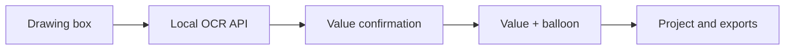

# Doc OCR Box

Local engineering-drawing OCR and ballooning application. The browser renders
PDF/image drawings and stores annotations; a local Python API runs PaddleOCR and
symbol recovery. No cloud OCR service is required.

## Current workflow

1. Open a PDF or image with **Open Drawing**.
2. Choose **Draw Value** and draw a box around one dimension or note.
3. Review the OCR result in the **Extracted Value** dialog.
4. Correct Value or Tolerance if required, then select **OK**.
5. Edit the same balloon later from the drawing or **Values** sidebar.
6. Optionally add Label, Method, and Tool metadata.
7. Save a reloadable `.docbox.json` project, create an internal inspection
   checksheet, or export JSON, CSV, XML, or a verification payload.

On a sheet with a coordinate point table, a whole-page scan also tags each of
its named points where the views call it out — see
[Reference points](#reference-points).

The box saved with a manually created value is the box drawn by the user.
Balloon numbers are always contiguous `1…N`; deleting a value immediately
renumbers the remaining values. Labels are optional metadata and do not create
separate boxes or balloons.

Numeric values without an explicit tolerance default to `0`. Complete decimal
or angular tolerances embedded in Value are normalized into the editable
Tolerance field. Malformed or incomplete tolerance expressions must be
corrected before a saved annotation can be exported.



## Quick start

Requirements:

- Node.js 20.19 or newer (required by the frontend test toolchain)
- 64-bit CPython 3.13 for the validated Windows OCR environment

Install the UI dependencies:

```bash
npm install
```

Create the Python environment and install the OCR backend:

```bash
python -m venv backend/.venv
backend/.venv/bin/python -m pip install -r backend/requirements.txt
```

On Windows PowerShell or Command Prompt, use:

```bat
py -m venv backend\.venv
backend\.venv\Scripts\python -m pip install -r backend\requirements.txt
```

Start the two processes from the repository root:

```bash
# Terminal 1
npm run ocr-api

# Terminal 2
npm run dev
```

Open `http://localhost:3002`. Check `http://127.0.0.1:8000/health` if the
frontend cannot reach OCR. A healthy configured service reports
`"paddleocr": true`.

Windows also has a one-shot backend setup and launcher:

```bat
scripts\win-ocr-setup.bat
```

The `ocr-api`, `ocr-api:debug`, and `ocr-api:debug:force` commands choose the
correct virtual-environment Python path on Windows, macOS, and Linux.

## Diagnostic logs

The backend writes newline-delimited JSON diagnostics to
`backend/logs/qtracx-backend.log` by default. `QTRACX_LOG_DIR`,
`QTRACX_LOG_LEVEL`, `QTRACX_LOG_MAX_MB`, and `QTRACX_LOG_BACKUP_COUNT` control
the destination, detail level, rotation size, and retained file count.

Each API response includes `X-Request-ID`. The same identifier follows a
queued OCR scan through its background worker without logging the uploaded
drawing, request body, recognized values, password, token, or database
connection string. Health and scan-progress polling log only at `DEBUG`.

The frontend includes the correlation ID on internal backend requests. Failed
API messages include the diagnostic reference. Browser failure reports use an
allow-listed schema and do not accept messages, stacks, drawing values,
filenames, browser URLs, or uploaded content.

## Internal checksheets

Choose **Export → Checksheet / Web** after ballooning a drawing. Enter a
checksheet name and one or more measured-part columns. The backend saves an
immutable snapshot of the specifications, balloon geometry, and original
PDF/image, then opens the first draft inspection run.

Use **Saved Checksheets** in the main toolbar to search definitions, reopen
drafts, start another inspection, view completed history, rename, duplicate,
archive, restore, or permanently delete an archived checksheet. Completing a
run locks its readings.

By default, durable checksheet data is written below
`backend/data/checksheets/`. Set these variables in `.env.local` when deploying:

```dotenv
# Absolute or repo-relative backend storage location.
CHECKSHEET_DATA_DIR=D:\doc-ocr-data\checksheets

# Maximum accepted original drawing size in MB (default 200).
CHECKSHEET_MAX_DOCUMENT_MB=200
```

Keep `CHECKSHEET_DATA_DIR` on a backed-up server volume. Other computers access
it through the backend API; the browser is not the persistence layer for these
checksheets.

## Reference points

Some sheets carry a small table of named points — `a`, `b`, `c` … — each with
its X/Y/Z coordinates, and print the bare name beside the matching feature in
the views. **Auto Balloon → Whole Page** reads that table and tags every place
the views call one of its names out, showing all three coordinates on the
sheet. **Reference Points** runs the same pass on its own, without rescanning
for dimensions.

Selecting a row highlights its markers on the drawing, dims the rest, and
tints the matching row of the drawing's own printed table. Each row keeps its
own colour; the name is always printed on the marker, so colour is only a way
of finding a point, never the thing that identifies it.

The table is found from its header, never from a caption: a column of short
names with X/Y/Z columns to its right. "(REFERENCE)", "(参考)" and no caption
at all all work, and a sheet whose tables have no coordinate columns reports
that rather than guessing. Point names are then located by matching the
table's own printed glyphs against the drawing, so nothing has to generalize
across fonts or scanners.

Names the matcher could not find are listed and their rows are marked `?` —
the coordinates are still correct, only the callout was not located.

These are not ballooned values: they carry no tolerance, no inspection
method, and no balloon number, and they are not saved into a project or an
export. The sheet is re-rendered several times finer than an auto-balloon
scan for this, because point names are printed at note size — which is also
why the pass runs after the scan rather than sharing its render.

## GD&T symbols

**GD&T Symbols** in the main toolbar finds feature control frames and GD&T
symbols on the current page, names each one, and reads a frame's compartments
into structured fields — characteristic, tolerance, zone shape, material
condition, and datum references in precedence order — rather than one flat
string.

Detections are drawn over the drawing and listed in the sidebar, leading with
the ones that need review. Selecting one shows its engineering meaning,
confidence, the text it reads with, and where it sits. Green means the
recognizer committed to the reading; amber means it did not, and the panel
offers the alternatives it could not separate so a correction is one click.

Some pairs *are* the same mark — counterbore and spotface, profile-of-a-line
and arc length, `Ø` and `SØ` — and those always come back amber with both
candidates named. An uncertain glyph is never promoted to a definitive
symbol, and a tolerance that could not be read says so instead of appearing
absent, because absent means something specific.

These are not ballooned values. They carry no tolerance of their own, no
inspection method and no balloon number, and they are not saved into a project
or an export. The page is re-rendered finer than the displayed canvas before
reading, because GD&T modifiers are printed at note size.

Corrections are recorded locally and can be read back through the API; see
[docs/GDT_RECOGNITION.md](docs/GDT_RECOGNITION.md) for the pipeline,
configuration and API, and [docs/GDT_DATASET.md](docs/GDT_DATASET.md) for what
the accuracy numbers do and do not mean.

## Hole callouts

A hole is not dimensioned like a length. It is written as a feature term and
the machining instructions that apply to it, in the glyph notation of ISO 129
and ASME Y14.5 — `↧` depth, `⌴` counterbore, `⌵` countersink:

| On the drawing | What it says |
| --- | --- |
| `Ø2.50 ↧13` | 2.5 diameter, 13 deep |
| `M3x0.5 - 6H ↧3` | tapped M3, thread 3 deep |
| `2 x Ø2.50 THRU ALL` | two holes, through every wall |
| `Ø4 H7 ↧10` | reamed to an H7 fit, 10 deep |
| `Ø6.50 ⌴Ø11 ↧4.40` | 6.5 drill, counterbored Ø11 by 4.4 deep |
| `Ø3.50 ⌵Ø7 X 90°` | 3.5 drill, countersunk to Ø7 at 90° |
| `↧0.90` | a depth on its own, the leader naming the feature |

All of these balloon as one value and are labelled **Hole** with a subtype
(Blind Hole, Counterbore, Countersink, Through Hole), or **Thread** when the
feature term is a thread.

PaddleOCR has no `↧` in its charset and returns `↓` for it, or `T` at small
text sizes; both are folded onto the canonical glyph before anything else
sees the text. The `T` repair only fires where it turns a string that parses
as nothing into a whole hole callout, so a fit class set tight against its
size (`Ø50T7`) and a part number (`ISD-600T500`) are left alone.

Where the recogniser drops the glyph outright, the two numbers either side
fuse — `Ø2.50 ↧13` becomes `Ø2.5013`. A read that keeps the glyph now
outscores the fused read of itself, so voting prefers it; a read confident
enough to win outright before voting can still publish the fused value.

## Table masks

A ruled grid is whitened out before the detector runs, so the scan does not
spend its budget reading a revision table. Because the masking happens before
detection, anything under a mask is not merely rejected — it is never seen,
and reaches neither a balloon nor the review queue.

That makes a wrong mask the most expensive mistake in the page route, and the
easiest to make: a machined block in orthographic projection *is* a grid of
rectangles — outline, pockets, steps — and by geometry alone it is a table.
One drawing produced 27 masks on a sheet with no tables, each tracing a view,
and 16 of the 17 dimensions its author pointed at as "clearly printed but not
detected" sat inside one.

So a group of adjacent cells is a table only if it looks like one inside:

- its rows are **text height** — median cell height at most 6.5% of the page;
- its cells are **populated** — more than half hold at least two glyph-sized
  ink components, or they average three or more.

Measured over six real sheets, every title block, tolerance table, parts list
and margin legend passes both, and every part view fails at least one. A
sparse revision table with mostly empty rows is no longer masked; its few
labels are read and then rejected by the revision and date rules instead.

If values are missing from a whole area of a sheet rather than here and
there, check the mask list: `analyze_page_layout(image).table_masks`. The
scan's `candidate_outcomes` will have no entry at all for anything underneath
one.

## View captions

`DETAIL C`, `SECTION A-A` and `SCALE 5:1` are never ballooned, and neither are
the pieces they break into when the detector splits them (`C`, `A-A`, `(3x)`,
`1:1`). The caption is matched by proximity as well as by its own text,
because a split caption leaves a bare letter nobody can match on wording.

Proximity is only allowed to take something short enough to be a piece of the
caption. A caption is a heading over a whole region, not a field label beside
its value, and the proximity radius is sized for the latter — about 240px at
250dpi. Without that guard every dimension inside a detail view was deleted
by the caption above it, and deleted *silently*: this is a hard exclusion, so
those values got no balloon and no review box either.

## Notes paragraphs

A drawing's NOTES paragraph is published as one **General Note** region, not
as one balloon per line. The detector breaks the same prose into word-sized
boxes, and the ones carrying a number — `R15`, a resonance frequency, a
standard's `500Y` — read as perfectly good engineering values on their own, so
every region a notes block covers is dropped in favour of the block.

Numbered markers are recognized in three shapes: `1.` / `1)`, a bare `1 WORD
WORD` with no separator, and a lone number box with the note's text beside it
(how wide-set CJK blocks come back). A sheet that prints its notes twice, once
per language, gets one region per block.

## Drawing and OCR tips

- Include the full `Ø`, `±`, degree, minute, or second symbol inside the box.
- A tall, narrow box is valid for a vertical dimension; the backend evaluates
  rotated variants.
- If OCR misses a symbol, insert it with the buttons in the Value editor.
- OCR is PaddleOCR-only. The former Tesseract worker is not used.
- OCR reads text, not glyphs: a `⌖` comes back as `+`. GD&T symbols are
  recognized by shape in a separate pass — see **GD&T symbols** above.

## Balloon appearance

Balloon appearance is deployment-controlled, not user-configurable. Drawing
markers and sidebar thumbnails both load `public/balloon-style.json`. Replacing
that one file changes every existing and future balloon after refresh; style is
not embedded in saved projects.

See [docs/BALLOON_STYLE.md](docs/BALLOON_STYLE.md) for the developer builder,
validation, replacement, and fallback process.

## Testing

Install test dependencies and run the fast verification suite:

```bash
npm install
backend/.venv/bin/python -m pip install -r backend/requirements-dev.txt
npm run verify
```

Use the equivalent `backend\.venv\Scripts\python` path on Windows. OCR/model
integration tests are intentionally separate:

```bash
npm run test:ocr
```

See [docs/TESTING.md](docs/TESTING.md) for the command matrix, Windows manual
acceptance checklist, and explicitly deferred follow-ups.

## Project layout

| Path | Purpose |
|---|---|
| `src/` | Next.js UI, annotation state, persistence, and exports |
| `backend/` | FastAPI, PaddleOCR, image processing, and durable checksheet storage |
| `public/balloon-style.json` | Single deployed balloon-style data file |
| `tools/balloon_builder/` | Developer-only artwork conversion and validation utility |
| `scripts/` | Cross-platform OCR and test launchers |
| `docs/` | Testing, balloon-style, and GD&T operating documentation |
